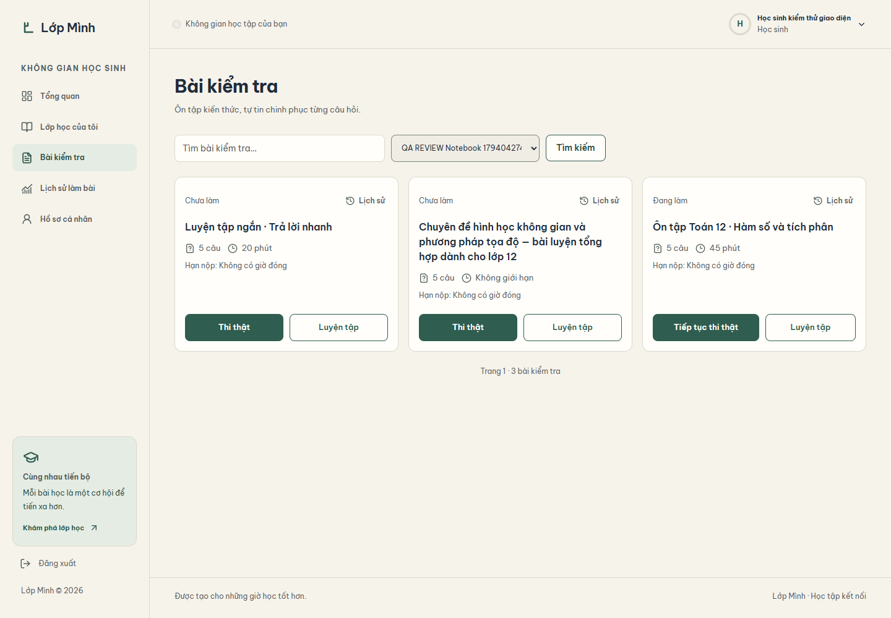
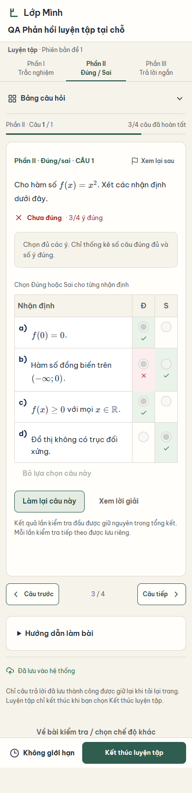

# Lớp Mình

Website tiếng Việt để giáo viên quản lý lớp, giao đề, tổ chức thi trực tuyến và cho học sinh luyện tập. Dự án có khu vực giáo viên/admin và học sinh, dùng dữ liệu thật qua Supabase cùng phân quyền ở server/database.

[Website đang chạy](https://web-nu-olive-jaqziuyjrj.vercel.app) · [Hướng dẫn Supabase](docs/CAI_DAT_SUPABASE.md) · [Schema và mẫu import](docs/import/README.md)

Website đang chạy cần tài khoản và quyền vào lớp; không công khai tài khoản admin, dữ liệu học sinh hay đáp án đề thật. Kho mã này không kèm dữ liệu production.



## Chức năng đã triển khai

**Giáo viên/admin**

- Tạo lớp, link mời, quản lý thành viên; tìm kiếm và phân trang danh sách lớp/đề/kết quả.
- Soạn câu một đáp án, nhiều đáp án, Đúng/Sai theo bốn nhận định và trả lời ngắn. Nội dung Unicode, LaTeX/KaTeX, bảng dữ liệu và hình minh họa riêng.
- Import JSON hoặc ZIP chứa JSON và thư mục `images`, kiểm tra schema/ID/ảnh ở server, xem trước/chỉnh sửa rồi tạo bản nháp. Không cần API AI cho JSON/ZIP; `package_id` giúp chống nhập trùng.
- Bật độc lập **Thi thật** và **Luyện tập**; cấu hình thời lượng hoặc không giới hạn, lịch mở/đóng, số lượt, đảo câu/lựa chọn và lịch công bố.
- Sửa nội dung sau khi có lượt làm: lượt cũ giữ snapshot, lượt mới dùng phiên bản mới. Chỉnh lịch cho lượt mới hoặc cả lượt đang làm theo lựa chọn của giáo viên.
- Chọn cách tính kết quả: giữ cách chấm cũ, thang THPT với cấu trúc 12/4/6 được kiểm tra, hoặc chỉ thống kê số câu/ý đúng. Xem báo cáo và xuất CSV.

**Học sinh**

- Đăng ký email/mật khẩu, xác minh email, đặt lại mật khẩu; phiên đăng nhập dùng cookie Supabase SSR.
- Vào lớp qua link mời, mở đề và tiếp tục lượt đang làm. Danh sách dạng thẻ có trạng thái và lịch sử của chính tài khoản.
- Tự lưu câu trả lời, đánh dấu câu, điều hướng theo phần và bảng số câu; đồng hồ dùng deadline từ server. Hệ thống chỉ báo đã lưu khi database xác nhận.
- Trong luyện tập, kiểm tra từng câu và xem đúng/sai ngay trên đáp án gốc; lời giải thu gọn, làm lại giữ kết quả lần kiểm tra đầu.
- Xem lại đúng snapshot và thứ tự của lượt đã nộp. Kết quả, đáp án, lời giải và ảnh tuân theo quyền/lịch công bố của đề.

Giao diện dùng nhận diện “sổ tay học tập”: nền giấy, xanh lá trầm, logo SVG chữ L và font Be Vietnam Pro hỗ trợ tiếng Việt; có bố cục desktop/mobile và hỗ trợ giảm chuyển động.



Ảnh trên dùng tài khoản QA, lớp và câu hỏi demo tự tạo; không có tên, điểm hay bài làm của học sinh thật. Các đề/hình/tài liệu của bên khác và ảnh kiểm thử với đề thật không được đưa vào repo này.

## Phần việc thực hiện trong dự án

Phạm vi đã xây dựng gồm xác định luồng giáo viên/học sinh, thiết kế nhận diện và giao diện, phát triển Next.js, tích hợp Supabase Auth/PostgreSQL/Storage, viết migration/RLS/RPC chấm điểm, import đề, quản lý phiên bản và lịch thi, kiểm thử và triển khai Vercel. Các thay đổi được kiểm tra bằng dữ liệu QA cô lập; không dùng dữ liệu giả thay backend trong ứng dụng.

Code và các biên bản kiểm thử local đã xác nhận luồng soạn/import/làm bài/chấm điểm, phản hồi luyện tập, snapshot, tự lưu/tải lại, quyền truy cập và công bố kết quả. Việc kiểm tra trên máy mới vẫn cần Supabase thật cho Auth/email/Storage/cron; build thành công không thay thế nghiệm thu các dịch vụ này.

## Công nghệ

- Next.js 16 App Router, React 19, TypeScript, Tailwind CSS 4.
- UI primitive nội bộ, Lucide, React Hook Form và Zod.
- Supabase Auth, PostgreSQL, RLS/RPC và Storage private; `@supabase/ssr` cho cookie/refresh phiên.
- KaTeX cho toán; PDF.js, Sharp và thư viện đọc ZIP cho nhập đề.
- Vitest/PGlite cho nghiệp vụ PostgreSQL, Playwright cho trình duyệt.

## Cài và chạy local

Cần Node.js **22.13+**, npm và một project Supabase riêng. Không trỏ môi trường phát triển vào dữ liệu trường/lớp thật nếu chưa kiểm soát thao tác ghi.

```powershell
git clone https://github.com/Hieu99-cell/lop-minh.git
cd lop-minh
npm.cmd ci
Copy-Item .env.example .env.local
# Điền biến môi trường, áp dụng migration và cấu hình Auth như bên dưới.
npm.cmd run dev
```

Mở http://localhost:3000. Trên macOS/Linux dùng `npm` và `cp .env.example .env.local`. Khởi động lại server sau khi đổi `.env.local`. Nếu chưa có cấu hình Supabase, ứng dụng hiển thị hướng dẫn kết nối.

| Biến                                   | Mục đích                                                |
| -------------------------------------- | ------------------------------------------------------- |
| `NEXT_PUBLIC_SUPABASE_URL`             | URL của project Supabase của bạn                        |
| `NEXT_PUBLIC_SUPABASE_PUBLISHABLE_KEY` | Publishable key; không dùng secret/service-role key     |
| `NEXT_PUBLIC_SITE_URL`                 | `http://localhost:3000` khi local, URL HTTPS khi deploy |
| `OPENAI_API_KEY`                       | Tùy chọn, chỉ server, dùng khi bật nhận diện ảnh/PDF    |
| `OCR_MODEL`                            | Model nhận diện, mặc định trong `.env.example`          |

JSON/ZIP không cần API AI. Nhận diện ảnh/PDF dùng OpenAI và có thể phát sinh chi phí theo tài khoản API; không cấu hình key thì giao diện báo cần cấu hình, không giả lập kết quả. Không commit `.env.local`, mật khẩu database hoặc token.

## Supabase và migration

Với **database mới**, chạy đủ `supabase/migrations/001_*.sql` → `022_*.sql` theo thứ tự, mỗi file một lần. Có thể dùng SQL Editor hoặc CLI:

```powershell
supabase login
supabase link --project-ref YOUR_PROJECT_REF
supabase db push
```

Kiểm tra project đích trước khi push. Với database đã chạy ứng dụng, chỉ áp dụng migration chưa có; không sửa/chạy lại file đã áp dụng và không nhập dump production vào repo.

Migration tạo schema, RLS, RPC, bucket `classroom` **private**, snapshot, luyện tập và báo cáo. Migration `004` dùng `pg_cron`; cần quyền bật extension. Chỉ expose schema phù hợp; không expose schema `private`. Ảnh được ký URL theo quyền người xem.

Bật Email signup và Confirm email, cấu hình Site URL/Redirect URLs, dùng Custom SMTP khi gửi email thực tế. Cơ chế bootstrap admin hiện nhận email chủ dự án đã xác minh trong migration; metadata từ client không cấp quyền admin. Khi dùng cho chủ sở hữu khác, tạo migration mới điều chỉnh điều kiện server sau khi rà soát, không tự cấp quyền từ frontend. Xem [hướng dẫn chi tiết](docs/CAI_DAT_SUPABASE.md).

## Kiểm tra

[Kết quả kiểm tra bộ mã public](docs/PUBLICATION_CHECKLIST.md) ghi rõ phạm vi quét dữ liệu và kiểm tra bản xuất sạch.

```powershell
npm.cmd run lint
npm.cmd run typecheck
npm.cmd test
npm.cmd run build
```

Kiểm tra bản production local:

```powershell
npm.cmd run start
# Terminal khác:
$env:E2E_BASE_URL='http://localhost:3000'
npx.cmd playwright test
```

Playwright mặc định dùng Edge tại đường dẫn Windows trong `playwright.config.ts`; đặt `PLAYWRIGHT_EXECUTABLE_PATH` để dùng Chromium/Chrome/Edge khác. Bộ test public chưa cấu hình backend chạy khi không đặt `E2E_BASE_URL`; bộ production chạy khi có biến này. Các test trình duyệt công khai không thay thế kiểm thử tài khoản giáo viên/học sinh thật.

## Cấu trúc mã nguồn

```text
src/app/               Routes, layouts, API và CSS theme
src/components/        UI, điều hướng, logo và render công thức
src/features/          Auth, lớp, đề, import, lượt làm, luyện tập và kết quả
src/lib/               Supabase SSR, quyền, validation và tiện ích
src/types/             Kiểu dữ liệu nghiệp vụ
supabase/migrations/   Schema, RLS, RPC, snapshot và chấm điểm
tests/                 Vitest/PGlite và Playwright
docs/import/           Schema v1, prompt ChatGPT và đề demo tự tạo
```

## Triển khai

Vercel chạy `npm ci` và `npm run build`; cấu hình các biến môi trường như local, đặt `NEXT_PUBLIC_SITE_URL` theo domain triển khai và cập nhật Supabase Redirect URLs. `vercel.json` hiện chọn Functions ở `sin1`; kiểm tra vùng backend và gói dịch vụ trước khi thay đổi. Không cần service-role key trên Vercel.

Việc đưa mã lên GitHub không tự thay đổi deployment đang chạy. Nhánh `prepare/public-release` dành cho bản mã public ban đầu; chỉ kết nối Git/Vercel hoặc merge vào nhánh production sau khi đã rà cấu hình deploy.

## Hướng phát triển, chưa triển khai

- Chấm tự luận, nhập Word trực tiếp và so sánh tương đương biểu thức đại số tùy ý.
- Thu bài offline đầy đủ và chống gian lận bằng camera.
- Google OAuth hiện tắt theo lựa chọn của chủ dự án; repo không hứa có đăng nhập Google hoạt động sẵn.
- Nghiệm thu tải lớn và tối ưu thêm theo quy mô sử dụng thực tế.

Giấy phép font Be Vietnam Pro được giữ tại [public/fonts/BeVietnamPro-OFL.txt](public/fonts/BeVietnamPro-OFL.txt). Nội dung mẫu chỉ minh họa định dạng và thao tác, không phải đề thi chính thức.
